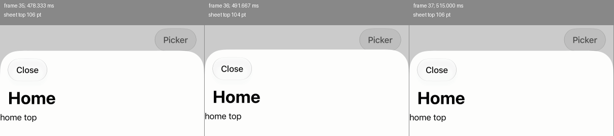

# iOS film cadence, 2026-11-12

`screenshot … over … every … window` cannot establish that every UIKit presentation
was captured. Its supported agent timing made the sheet unanimated and returned
13 views of its settled position. The same loop against a live UIKit host missed
38 recorded sheet-edge positions, including a recorded A→B→A excursion. No capture
mechanism or runtime behavior changes in this measurement (QUEUE, LLP 1143 §5).

## Runs

Source: `cf9208cbe04dc0cfeb1bdc3b30c88d4355f39920`, with no source changes.
macOS 27.0.1 (26A434), Xcode 27.2 (27B52), Bun 1.4.2; `lane-sim-1`, iPhone 18 Pro,
iOS 27.0, portrait, 1206×2622 pixels at 3 px/point. Only this lane's simulator was used.

The existing `scripts/fixtures/cover-scroll.contract` presents a UIKit sheet from
the native Picker bar button (`open-picker`). Caltrain supplied the host binary;
the fixture supplied the whole plan. Native chrome was `platform`, input was the default
host activation, and the contact sheet scale was 1. Source film frames remain at 3.

| Run | Native timing | Film | Capture-start gaps, min / median / max | Video samples | Distinct recorded sheet-edge positions |
| --- | --- | --- | --- | --- | --- |
| [agent](agent/capture.json) | Agent, unanimated | 13 samples, 50 virtual ms apart | 129.74 / 135.02 / 145.40 ms | 91 | 1; all film samples have it |
| [platform](platform/capture.json) | Platform | Refused before the tap | — | 50 | 30 |
| [loop-probe](loop-probe/capture.json) | Platform, diagnostic override | 13 samples, 50 virtual ms apart | 130.60 / 148.72 / 195.23 ms | 140 | 44; 38 absent from the film within ±1 point |

The agent run's capture starts span 1634.05 wall ms: 7.34 samples/s. Its screenshot
calls alone cost 45.31–55.54 ms; clock requests, decoding and assembly add time.
The probe spans 1855.34 wall ms: 6.47 samples/s. Neither is a 20 fps recording.
The agent clock advanced 600 ms in each film; the probe began at 201.445 ms.

The probe used `open({ timing: 'agent', env: { EXACT_AGENT_TIMING: 'platform' } })`.
This deliberately gives the driver and host different timing modes so the existing
loop can be observed during native motion. It is an unsupported diagnostic, not a
supported way to film UIKit. The ordinary `timing: 'platform'` call refused with:

> screenshot over: film is the agent clock's, and --timing platform leaves UIKit's motion on its own

## Recording and sampling

The build and plan commands, run offline from the repository root, were:

```sh
PATH="$HOME/.bun/bin:$PATH" CARGO_NET_OFFLINE=true EXACT_SHOW_SIMULATOR=0 \
  bun host/apple/build.mjs --ios caltrain-apple --sim "$EXACT_LANE_SIM"
CARGO_NET_OFFLINE=true cargo run --offline --profile host-dev -p contract -- build --help
target/host-dev/contract build scripts/fixtures/cover-scroll.contract \
  -o target/ios-film-measurement/cover-scroll.plan
```

Each run opened `scripts/agent.mjs`'s `open` API with that plan, `host: 'ios'`,
`app: 'caltrain'`, `chrome: 'platform'`, `scale: 1`, and `EXACT_SIM` naming this lane.
It ran this sequence:

1. `clock('settle')`, read state, and take `screenshot(before, true)`.
2. Start `xcrun simctl io <udid> recordVideo --codec=h264 --mask=ignored display.mov`;
   await its `Recording started` stderr message.
3. In the platform control, attempt `screenshot(film, {over:600,every:50,window:true})`
   and retain its refusal. Then, in every run, `tap('open-picker')`.
4. In the agent and probe runs, call that same film form immediately after the tap.
5. `clock('settle')`, read state, and take `screenshot(after, true)`.
6. Send SIGINT to the recorded recorder PID and await its exit.

An observer around `session.carrier.screenshot` stored `performance.now()` before
and after forwarding the unchanged arguments. `capture.json` retains these intervals,
the returned clock tags and the operation boundaries. It omits the opaque-point grid
and unrelated state. Its wall times are relative to the start of each run, not to
video PTS. Recording readiness is not a synchronization of those two clocks.

`AVAssetReaderTrackOutput`, with `kCVPixelFormatType_32BGRA`, decoded every video
sample to an 8-bit PNG through Core Graphics and ImageIO. Samples were read in order,
without a requested frame rate or interpolation. `comparison.json` retains every PTS
in seconds; unavailable sample durations are null. The three movie durations are
4.015, 3.3383 and 4.995 seconds, respectively.

The display recording is independent of the app's `drawHierarchy` snapshot. It is a
variable-rate stream of simulator display updates, not proof of panel scanout.
During the platform control's sheet movement, adjacent recorded intervals were
15–18.33 ms, median 16.67 ms. Across whole recordings, intervals ranged from
1.67 to 1160 ms, including quiet periods and updates closer than one 60 Hz refresh.
Do not count these samples as physical refreshes or infer a display rate from the
movie's average frame rate.

## Adjacent changes and the excursion

The reported differences use `scripts/png.mjs`: shrink to 402×874, then crop the rectangle
`(0,70,402,770)` in points. This excludes the status bar and home indicator.
`diff` reports mean absolute RGB difference on a 0–255 scale, and the share of pixels
with a maximum channel difference above 8. Every adjacent pair, not just the largest,
is retained in each run's `comparison.json`.

| Source | Largest pair, zero-based | Video PTS, ms | Mean RGB change | Pixels above 8 |
| --- | --- | --- | --- | --- |
| Agent display | 2→3 | 125→128.333 | 2.24145 | 1.4363% |
| Agent film | 1→2 | Agent clock 50→100 | 0.0000183 | 0% |
| Platform display | 2→3 | 120→123.333 | 24.89655 | 99.6204% |
| Probe display | 2→3 | 118.333→121.667 | 49.52199 | 99.6782% |
| Probe film | 0→1 | Agent clock 201.445→251.445 | 33.35094 | 61.3084% |

The largest live changes are the sheet's dimming backdrop. In the platform control,
it darkens in two updates; in the probe, one. Neither change returns to the old image.
The agent film has no changed pixel above the comparison band in any adjacent pair.
The probe has four changing samples followed by nine samples at the final position.

For each consecutive triple A,B,C, select a candidate when both adjacent mean
differences are at least 0.1 and `diff(A,C).mean ≤ 0.2 × min(diff(A,B).mean,
diff(B,C).mean)`. There is one candidate in the probe's display recording and none
in the other recordings or either film. This is a bounded image comparison, not
a claim that every possible local flash is detected.

| Frame | PTS | Sheet edge at the center column |
| --- | --- | --- |
| 35 | 478.333 ms | 106 pt |
| 36 | 491.667 ms | 104 pt |
| 37 | 515.000 ms | 106 pt |

A→B and B→C have means 0.99527 and 0.99503; A→C is 0.01043, only 1.05% of the
smaller jump. The middle sample lasts 23.33 ms until C. Its sheet and heading move
up and return. The film's sheet-edge positions are 584, 118, 66, 63, then 62 points;
none represents that excursion. The annotated crop and 5× amplified differences
are retained:



This is a candidate flash in the recording made during the diagnostic capture.
It was absent from the control without filming. That association does not establish
whether drawing the snapshot, another part of the loop, or the simulator recorder
caused it, or whether a physical display would have shown it.

## Coverage evidence and limits

`geometry.json` measures the white sheet at center column x=201 after shrinking to
1x. Starting at y=55, it finds the first run of five pixels with all RGB channels above
245. A white pixel at y=55 marks the initial home screen; no qualifying run marks a
sheet below the screen. The 44 distinct recorded edge positions in the probe include
38 with no film position within ±1 point. This is a lower bound on omitted geometry
states across the whole recorded transition, including its start before the first
film sample. It does not divide omissions between tap latency and the sampling loop,
or assign a screenshot to a presented frame. H.264 and
the app's drawing also differ in color, so pixel equality across those paths would
be the wrong matching criterion. The platform control has 30 distinct positions
and the supported agent run has only the final one.

Each run retains `display.mov`, a `display-sheet.png` contact sheet and
`comparison.json`, which names the display frames selected for its contact sheet.
The native-size frames are not kept: decode `display.mov` as above to recover them.
The films are retained as contact sheets, with duplicates included.

The implementation explains the measured limit: `film` advances the agent clock;
its iOS carrier returns before `withDisplay`, so even `window` films are app drawings.
The host uses `drawHierarchy(afterScreenUpdates: true)` and skips motion settlement
for film frames. Native navigation disables animation under agent timing
(`NavigationIOS.swift`, `ExactEnv.agentFreezes`). Increasing the requested virtual
sample rate therefore cannot qualify live UIKit presentations.

What remains of the QUEUE item: select and qualify capture of live display updates,
with presentation timestamps and a demonstrated account of omitted or repeated
frames; determine the candidate excursion's cause without assuming the observer is
passive. No such mechanism is proposed here. A device run must independently record
the same transition, with and without observation, to settle physical presentation
and the candidate flash. This simulator measurement makes neither device claim.
